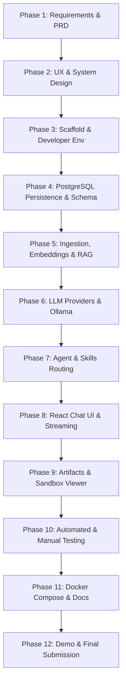

# Product Requirements Document (PRD)
## The Lenny Growth Assistant

- **Document Version:** 1.0.0
- **Status:** Approved / Phase 1 Complete
- **Target Release:** v1.0.0 (Forward Deployed Engineer Demonstration)
- **Author:** Senior Forward Deployed Engineer & AI Architect

---

## 1. Primary Users & Jobs To Be Done (JTBD)

### 1.1 Target Personas
1. **Product Manager / Growth Lead (Primary Persona):**
   - High-velocity product builder designing onboarding funnels, retention loops, activation milestones, and pricing models.
   - Requires empirical practitioner guidance from vetted industry peers.
2. **Growth Marketer / Essayist / Founder (Secondary Persona):**
   - Content operator and founder communicating frameworks to their teams or audience.
   - Requires rapid synthesis of rich discussions into publishable, structured essays.
3. **Senior Technical Evaluator (Auditor Persona):**
   - Assesses the system for architectural discipline, defensive coding, sandboxing, automated testing, and local hardware feasibility.

### 1.2 Jobs To Be Done (JTBD)
- **JTBD-1 (Grounded Retrieval):** *When I need to make an evidence-backed decision on growth or PMF, I want to query Lenny's transcript archive and get mathematically verified citations, so that I don't implement hallucinated strategies.*
- **JTBD-2 (Multi-turn Contextual Follow-up):** *When an initial answer opens up deeper tactical questions, I want to ask follow-up questions that preserve conversational context and previous citations, so that I can explore nuanced topics iteratively.*
- **JTBD-3 (Ship 30 for 30 Synthesis):** *When I discover an impactful playbook in an episode, I want to transform it into a structured 1,250-word atomic essay with a compelling hook, 3 narrative pillars, and actionable takeaways, so that I can immediately share it with my team.*
- **JTBD-4 (Safe Artifact Exploration):** *When the assistant generates Markdown or HTML/CSS visual assets, I want to preview them immediately in a side-by-side viewer that cannot compromise my browser or security, so that I can safely inspect and export the results.*

---

## 2. Problems & Proposed Solution

### 2.1 The Core Problems
1. **Hallucination & Fabrication:** Generic LLMs invent quotes, attribute statements to the wrong guests, or blend disparate frameworks without provenance.
2. **Manual Synthesis Overhead:** Ingesting 2-hour podcast transcripts to extract 3 key takeaways wastes valuable leadership hours.
3. **Execution Safety & XSS:** Displaying raw LLM-generated HTML/CSS in web apps risks Cross-Site Scripting (XSS), credential exfiltration, and parent DOM manipulation.
4. **Hardware Bottlenecks on Constrained Systems:** Running heavy AI stacks on an 8 GB RAM laptop causes memory thrashing, thermal throttling, and system freezes.

### 2.2 The Proposed Solution
"The Lenny Growth Assistant" is a local-first conversational AI workbench engineered for speed, privacy, and reliability:
- **Retrieval-Augmented Generation (RAG):** Uses PostgreSQL + `pgvector` with local embeddings (`nomic-embed-text`) to ground every claim with precise episode metadata, guest names, and timestamps.
- **Strict Evidence Guardrails:** Enforces a cosine distance threshold (< 0.65 similarity cut-off). When evidence is insufficient, the system explicitly refuses to guess.
- **Dedicated Skill Router:** A lightweight, transparent Python router that dispatches queries to specialized skills (`rag_qa_skill`, `ship30_essay_skill`, `artifact_generator_skill`).
- **Sandboxed In-App Viewer:** Renders generated HTML/CSS artifacts within a hardened `<iframe>` using strict Content Security Policies and complete parent origin isolation.
- **Multi-Model Support:** Local Ollama `llama3.2:3b` as the primary local engine, with an optional cloud adapter for OpenAI/Anthropic when keys are available.

---

## 3. Measurable Success Metrics

| Metric | Target Baseline | Measurement Method |
|---|---|---|
| **Citation Accuracy** | 100% of factual assertions cite an ingested chunk | Automated assertion in pytest test suite |
| **Hallucination Refusal Rate** | 100% refusal on out-of-domain queries | Test with out-of-corpus queries (e.g., nuclear fusion, gardening) |
| **Time-to-First-Token (TTFT)** | < 2.5 seconds on local `llama3.2:3b` | Measured via backend SSE stream start timestamp |
| **Essay Word Count Compliance** | 1,250 words (± 15%) with all 5 core elements | Word count and structural regex validation in tests |
| **Memory Footprint (Host RAM)** | < 4.5 GB total for all containers + Ollama | Monitored via `docker stats` and macOS Activity Monitor |
| **Automated Test Coverage** | > 85% line coverage on backend core modules | `pytest --cov=app tests/` |
| **Security Isolation** | 0 parent DOM or cookie leakage from artifacts | Automated Playwright / unit test asserting blocked `parent.document` access |

---

## 4. Assumptions & Open Questions

### 4.1 Assumptions
1. **Local Model Availability:** The host machine has Ollama installed with `llama3.2:3b` (2.0 GB) and `nomic-embed-text` (274 MB) available.
2. **Deterministic Data Corpus:** The initial release includes a seed batch of 5 high-signal, diverse podcast transcripts formatted in JSON/Markdown.
3. **Single-User Workspace:** System runs locally for a single user/workstation without requiring multi-tenant auth or billing infrastructure.
4. **Sequential Turn Generation:** One active LLM inference stream per session to honor the dual-core Intel i5 CPU budget.

### 4.2 Open Questions (Non-Blocking)
- *Q1: Should essay outputs automatically trigger artifact generation?*
  - **Decision:** Yes. The `ship30_essay_skill` generates both a conversational message and a linked HTML artifact rendered in the preview pane.
- *Q2: What happens if Ollama crashes mid-generation?*
  - **Decision:** The backend catches the streaming disconnect, rolls back the incomplete assistant message, logs the incident, and emits a structured error event across the SSE stream.

---

## 5. Scope Boundaries: Mandatory vs. Optional

### 5.1 Mandatory Assignment Requirements
- [x] Full-stack architecture: FastAPI (Python 3.12+), React + TypeScript + Vite, PostgreSQL.
- [x] Local LLM demo using Ollama (`llama3.2:3b`).
- [x] Replaceable Cloud LLM Provider adapter (OpenAI / Anthropic compatible).
- [x] Independent chat sessions and persistent history in PostgreSQL.
- [x] Transcript ingestion, chunking, embeddings, indexing, and source citations.
- [x] Grounded answers that explicitly declare when evidence is insufficient.
- [x] Dedicated Ship 30 for 30 essay generation skill (~1,250 words, hook, progression, skimmability, takeaways).
- [x] Markdown and HTML/CSS artifact generation with side-by-side in-app viewer.
- [x] Strict security sandboxing for generated HTML rendering.
- [x] Structured logging, health endpoints, graceful failure handling.
- [x] Automated tests (unit, integration, routing, persistence) and manual UI test plan.
- [x] Packaging: Docker Compose and clear local setup documentation.

### 5.2 Optional Enhancements (Out-of-Scope for V1.0)
- Real-time audio ingestion and automatic Whisper transcription.
- Multi-user authentication, SSO, and team-based RBAC.
- External social publishing webhooks (Twitter/X, LinkedIn, Substack).
- Voice audio synthesis / TTS for podcast answers.

---

## 6. End-to-End User Journeys

### Journey 1: Grounded Q&A
1. User opens the application in a web browser (`http://localhost:5173`).
2. User selects an existing session or clicks **"New Session"**.
3. User types: *"What are the key retention metrics recommended for consumer social apps?"*
4. System queries `pgvector` for transcript chunks matching semantic embedding.
5. Router identifies RAG intent -> Constructs grounded prompt containing retrieved quotes.
6. Local LLM streams the grounded answer into the chat UI, formatted with inline bracket citations:
   - Example: *"According to Elena Verna [Elena Verna - Product-Led Growth - 14:20], retention is defined by..."*
7. User clicks the citation badge to inspect the original transcript excerpt and episode metadata.

### Journey 2: Contextual Follow-Up Question
1. Continuing from Journey 1, user asks: *"How does that differ for B2B SaaS?"*
2. System loads conversation history (last 6 turns) + queries RAG for B2B SaaS retention benchmarks.
3. Local LLM receives prior conversation context + new retrieved chunks.
4. Assistant synthesizes the comparative contrast without re-asking for context, maintaining continuity and citing relevant B2B episodes.

### Journey 3: Ship 30 for 30 Essay Generation
1. User types: *"Write a Ship 30 for 30 essay on Gustaf Alströmer's framework for finding Product-Market Fit."*
2. Router detects essay synthesis intent -> Selects `ship30_essay_skill`.
3. System retrieves relevant transcript chunks from Gustaf Alströmer's episode.
4. Skill executes structured prompt enforcing the Ship 30 for 30 structure:
   - **The Hook:** A punchy, counterintuitive 1-line opening.
   - **The Progression:** 3 distinct narrative pillars with bolded lead sentences for skimmability.
   - **The Actionable Takeaway:** 3 concrete steps a product team can implement today.
   - **Word count:** Target ~1,250 words grounded in cited transcript evidence.
5. Assistant streams the complete essay into the chat feed and automatically registers an Artifact ID.

### Journey 4: Artifact Creation & Sandboxed Viewing
1. Upon completing the essay or a dedicated artifact request (e.g., *"Generate an HTML visual cheat sheet for this framework"*), an **Artifact Card** appears in the chat message.
2. User clicks **"Open Preview"** -> The UI transitions into a side-by-side split screen.
3. The right pane instantiates a sandboxed `<iframe>` rendering the generated HTML/CSS.
4. The sandbox isolates all script execution: attempts to query `window.parent`, access `localStorage`, or read session cookies fail with browser security errors.
5. User toggles between "Visual Preview", "Code View", and clicks "Copy to Clipboard" or "Download HTML".

---

## 7. Functional & Non-Functional Requirements

### 7.1 Functional Requirements (FR)

#### FR-1: Session & Conversation Persistence
- **FR-1.1:** Sessions stored in PostgreSQL table `sessions` (`id`, `title`, `created_at`, `updated_at`, `metadata`).
- **FR-1.2:** Messages stored in `messages` (`id`, `session_id`, `role`, `content`, `citations`, `artifact_id`, `created_at`).
- **FR-1.3:** Complete RESTful CRUD API: `POST /api/sessions`, `GET /api/sessions`, `GET /api/sessions/{id}`, `DELETE /api/sessions/{id}`.
- **FR-1.4:** History retention: Full conversational context loaded upon navigating between sessions.

#### FR-2: Knowledge Retrieval & Source Traceability (RAG)
- **FR-2.1:** Ingestion CLI/script parses transcript files with metadata (`episode_title`, `guest`, `date`, `url`, `content`).
- **FR-2.2:** Semantic chunker splits text into 500–800 token windows with 100-token overlap, preserving speaker turns.
- **FR-2.3:** Vectors stored in `transcript_chunks` with `pgvector` indexing (768 dimensions for `nomic-embed-text`).
- **FR-2.4:** Retrieval queries perform cosine similarity ranking with Top-K (3 to 5 chunks).
- **FR-2.5:** Every retrieved chunk attached to assistant response payload with speaker, episode title, and timestamp.
- **FR-2.6:** Strict refusal threshold: If top chunk similarity is < 0.65, system outputs: *"Insufficient evidence found in the ingested transcripts to answer this query."*

#### FR-3: Skill & Agent Routing Layer
- **FR-3.1:** Deterministic Python router evaluating intent based on prompt semantics and keywords:
  - `rag_qa_skill`: Standard grounded question answering.
  - `ship30_essay_skill`: Long-form structured essay synthesis (~1,250 words).
  - `artifact_generator_skill`: Standalone HTML/CSS and Markdown code artifact generation.
  - `fallback_chat_skill`: General conversational guidance.
- **FR-3.2:** Explicit parameter validation and typed contracts for each skill.

#### FR-4: Artifact Generation & In-App Sandboxed Viewer
- **FR-4.1:** Artifacts stored in `artifacts` table (`id`, `session_id`, `title`, `artifact_type`, `content`, `created_at`).
- **FR-4.2:** Side-by-side collapsible split pane in React frontend.
- **FR-4.3:** Multi-tier security sandbox:
  - Sandboxed iframe with `sandbox="allow-scripts"` (strictly NO `allow-same-origin`, NO `allow-top-navigation`, NO `allow-forms`, NO `allow-modals`).
  - Restrictive Content Security Policy (`default-src 'none'; style-src 'unsafe-inline'; script-src 'unsafe-inline'; img-src data: https:;`).
- **FR-4.4:** Markdown rendering via sanitized renderer with syntax-highlighted code blocks.
- **FR-4.5:** Export actions: Copy raw code, download file.

#### FR-5: Model Abstraction & Provider Management
- **FR-5.1:** Unified `LLMProvider` interface with streaming and completion methods.
- **FR-5.2:** `OllamaProvider`: Local inference via `http://localhost:11434` with model `llama3.2:3b`.
- **FR-5.3:** `CloudProvider`: Replaceable adapter supporting OpenAI (`gpt-4o-mini`) and Anthropic (`claude-3-5-sonnet`).
- **FR-5.4:** Dynamic provider toggle visible in UI header without backend restart.
- **FR-5.5:** Graceful error handling for missing keys, connection timeouts, and offline daemons.

### 7.2 Non-Functional Requirements (NFR)

#### NFR-1: Performance & Resource Constraints
- **Hardware Target:** MacBook Air (Intel Core i5, 8 GB RAM).
- **RAM Limits:** Backend + Frontend + PostgreSQL < 2.0 GB RAM total. Ollama < 2.5 GB RAM.
- **Latency:** TTFT < 2.5s on local `llama3.2:3b`. Vector query response < 120ms.

#### NFR-2: Reliability & Observability
- **Health Probes:** `GET /api/health` returning database connectivity, vector index count, Ollama daemon status, and active model.
- **Structured JSON Logging:** Request correlation IDs, prompt token counts, retrieval latencies, and error stack traces.
- **Resilient Recovery:** Graceful HTTP 503 response with diagnostic instructions if Ollama is unreachable.

#### NFR-3: Security & Data Privacy
- **Local-First Privacy:** Zero network calls to external APIs in default local mode. Transcripts and user chats remain on-disk.
- **Sanitized Execution:** Untrusted generated HTML executed exclusively in origin-isolated iframe sandbox.
- **Zero Secrets:** Strict `.env` isolation; `.env.example` template provided.

#### NFR-4: Accessibility & Design Quality
- **Aesthetics:** Sleek dark-mode interface with Tailwind/CSS custom tokens, modern typography (Inter), responsive down to 1024px.
- **Accessibility:** Keyboard navigable, WCAG AA contrast ratios, screen-reader friendly ARIA labels.

---

## 8. Acceptance Criteria for Every Core Requirement

| ID | Core Requirement | Acceptance Criteria |
|---|---|---|
| **AC-1** | Session Persistence | User creates 3 sessions, posts 2 messages each, restarts backend and browser. All 3 sessions and their exact message histories reload from PostgreSQL intact. |
| **AC-2** | RAG Grounding & Citations | Asking *"How did Superhuman measure product-market fit?"* returns Rahul Vohra's framework, citing the exact episode title, guest name, and transcript excerpt. |
| **AC-3** | Evidence Insufficiency Refusal | Asking *"What did Lenny's guest say about nuclear submarine reactors?"* triggers similarity cut-off (< 0.65) and outputs the exact refusal string: *"Insufficient evidence found in the ingested transcripts to answer this query."* |
| **AC-4** | Contextual Follow-Up | Asking *"Who said that?"* immediately after a grounded answer accurately names the speaker from the preceding turn's citation context. |
| **AC-5** | Ship 30 for 30 Essay Skill | Generating an essay on an episode yields an output containing: (1) 1-line Hook, (2) 3 narrative pillars with bold leads, (3) actionable takeaway, (4) length of ~1,250 words (± 15%), and (5) transcript citations. |
| **AC-6** | Sandboxed HTML Rendering | An HTML artifact rendered in the preview pane cannot access `window.parent.document`, cannot read `document.cookie`, and cannot navigate top-level window. |
| **AC-7** | Model Switchability | Switching active provider from `local_ollama` to `cloud_openai` in settings routes subsequent queries through the cloud adapter when key is present; returns clean validation error when key is absent. |
| **AC-8** | Graceful Ollama Failure | Stopping the Ollama process (`pkill ollama`) and submitting a message results in an immediate 503 HTTP response with human-readable remediation steps (*"Ollama is unreachable..."*). |
| **AC-9** | Automated Test Suite | Running `pytest` executes unit, integration, persistence, and routing tests with 100% passing rate and >85% code coverage. |
| **AC-10** | Dockerized Deployment | Running `docker compose up --build` boots PostgreSQL (pgvector), backend, and frontend with all health checks returning green. |

---

## 9. Risk Analysis & Mitigation Strategies

```
+---------------------------------------------------------------------------------+
|                                 RISK MATRIX                                     |
+----------------------+--------------------+-------------------------------------+
| Risk Domain          | Severity / Likelihood | Mitigation Strategy                |
+----------------------+--------------------+-------------------------------------+
| 1. Hallucinations    | HIGH / MEDIUM      | Cosine similarity threshold (<0.65),|
|                      |                    | strict system prompt, forced quotes |
| 2. Data Provenance   | HIGH / LOW         | Mandatory chunk metadata schema     |
|                      |                    | (guest, title, timestamp, URL)      |
| 3. Model Latency     | MEDIUM / HIGH      | SSE token streaming for low TTFT;   |
|                      |                    | Top-K limited to 3-5 chunks         |
| 4. Memory Footprint  | HIGH / MEDIUM      | llama3.2:3b (2GB) + nomic-embed;    |
|                      |                    | single concurrency on Intel i5      |
| 5. Privacy / Leaks   | HIGH / LOW         | Local-first offline default;        |
|                      |                    | .env exclusion, zero cloud telemetry|
| 6. Database Outages  | HIGH / LOW         | SQLAlchemy connection pooling,      |
|                      |                    | auto-reconnect, health checks       |
| 7. Unsafe HTML (XSS) | CRITICAL / HIGH    | Sandboxed iframe (no same-origin),  |
|                      |                    | restrictive CSP, origin isolation   |
+----------------------+--------------------+-------------------------------------+
```

1. **Hallucinations:** Mitigated by injecting verbatim transcript snippets and instructing the model to declare insufficient evidence when context similarity is low.
2. **Data Provenance:** Every ingested chunk stores immutable metadata (`episode_title`, `guest`, `date`, `timestamp`, `url`), exposed directly in the UI citation drawer.
3. **Model Latency:** Mitigated by Server-Sent Events (SSE) streaming; user sees tokens immediately as generated rather than waiting for a 30-second block completion.
4. **Memory Constraints (8GB RAM):** Mitigated by selecting `llama3.2:3b` and `nomic-embed-text`, which together consume ~2.3 GB RAM, leaving ample headroom on the MacBook Air.
5. **Data Privacy:** Local default ensures zero external data transmission. Cloud adapter is opt-in only.
6. **Database Outages:** Defensive DB session wrappers with automatic connection retry and graceful HTTP 500/503 status code responses.
7. **Unsafe HTML / XSS:** Rendered exclusively inside an isolated iframe with `sandbox="allow-scripts"` (without `allow-same-origin`) and strict Content Security Policy.

---

## 10. Milestones, Dependencies & Prioritized Backlog



### Prioritized Implementation Backlog

| Sprint / Phase | Focus Item | Dependency | Priority |
|---|---|---|---|
| **Phase 1** | Discovery Brief, PRD.md, Acceptance Criteria | None | P0 (Completed) |
| **Phase 2** | `design.md`, `architecture.md`, Wireframes, Data Flow | Phase 1 | P0 |
| **Phase 3** | Repo Scaffold, FastAPI + Vite setup, Health Probes | Phase 2 | P0 |
| **Phase 4** | PostgreSQL 16 + pgvector schema, Session & Message CRUD | Phase 3 | P0 |
| **Phase 5** | Transcript Ingestion, nomic-embed indexing, RAG Retriever | Phase 4 | P0 |
| **Phase 6** | `LLMProvider` abstraction, Ollama integration, Cloud failover | Phase 5 | P0 |
| **Phase 7** | Tool/Skill Router, Grounded QA skill, Ship 30 for 30 skill | Phase 6 | P0 |
| **Phase 8** | React Chat UI, Session drawer, SSE Streaming | Phase 7 | P0 |
| **Phase 9** | Side-by-side Artifact Viewer, Sandboxed iframe rendering | Phase 8 | P0 |
| **Phase 10** | Pytest suite (>85% cov), UI test plan, Error scenarios | Phase 9 | P0 |
| **Phase 11** | Docker Compose, README, `.env.example`, Troubleshooting | Phase 10 | P0 |
| **Phase 12** | GitHub preparation, Demo run, Final submission verification | Phase 11 | P0 |
