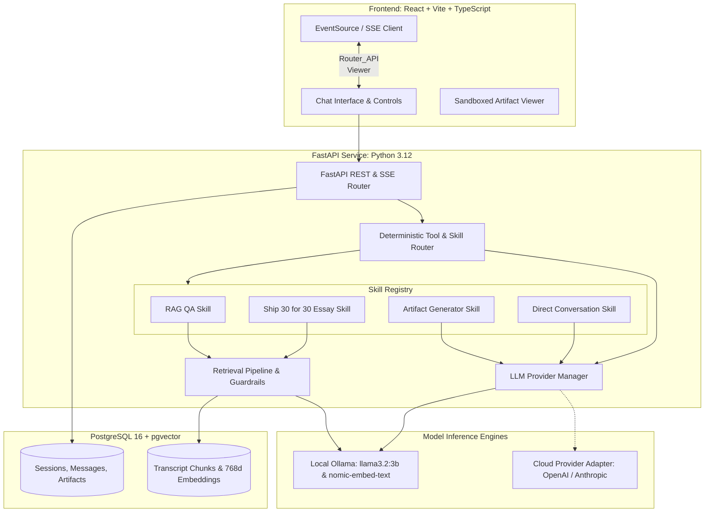
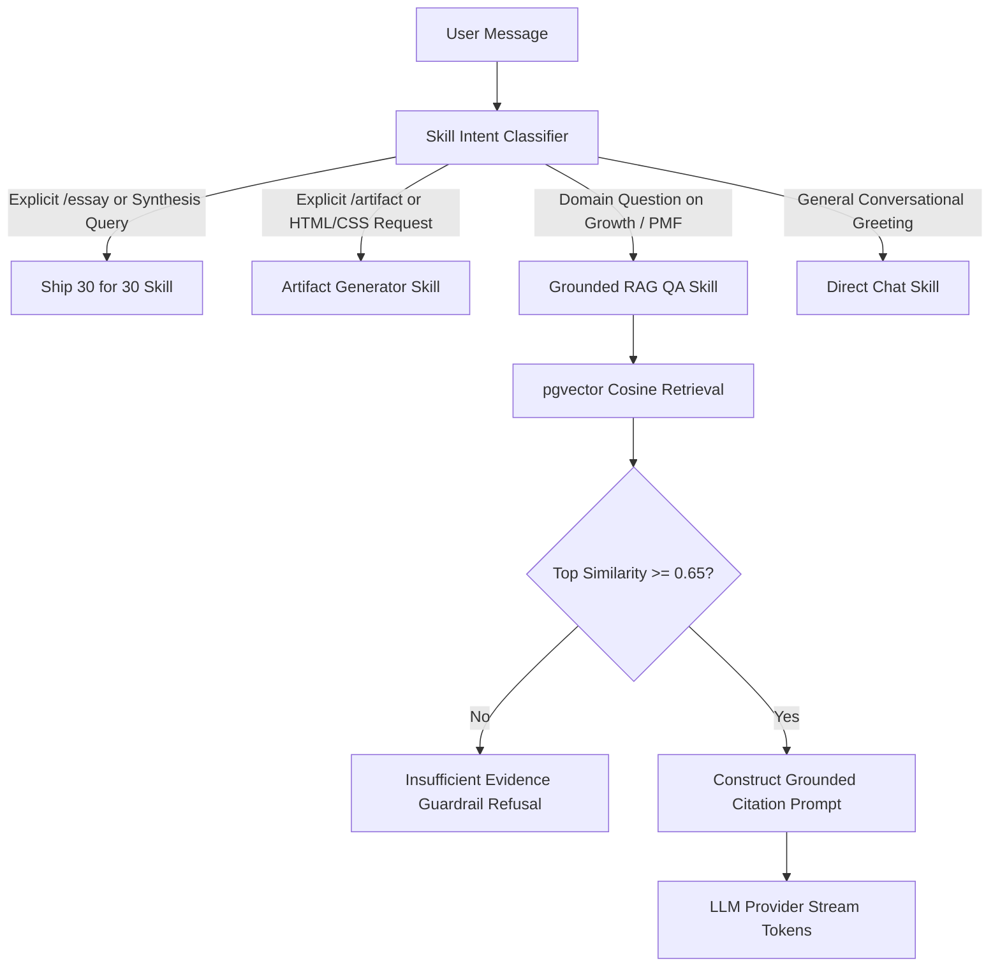
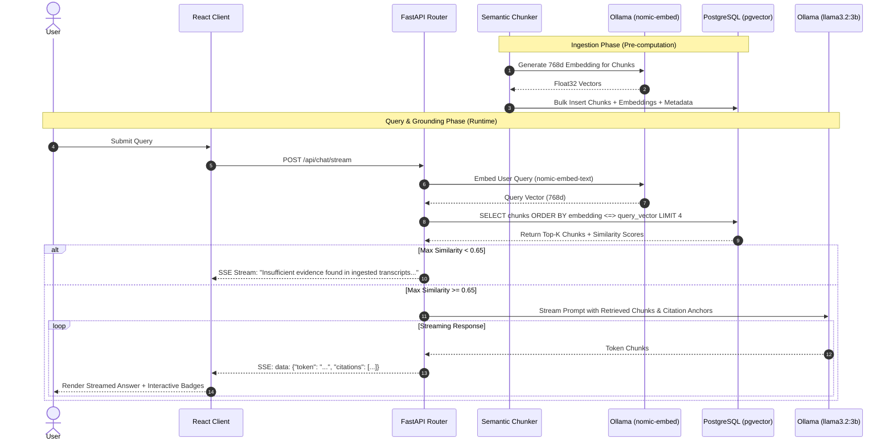
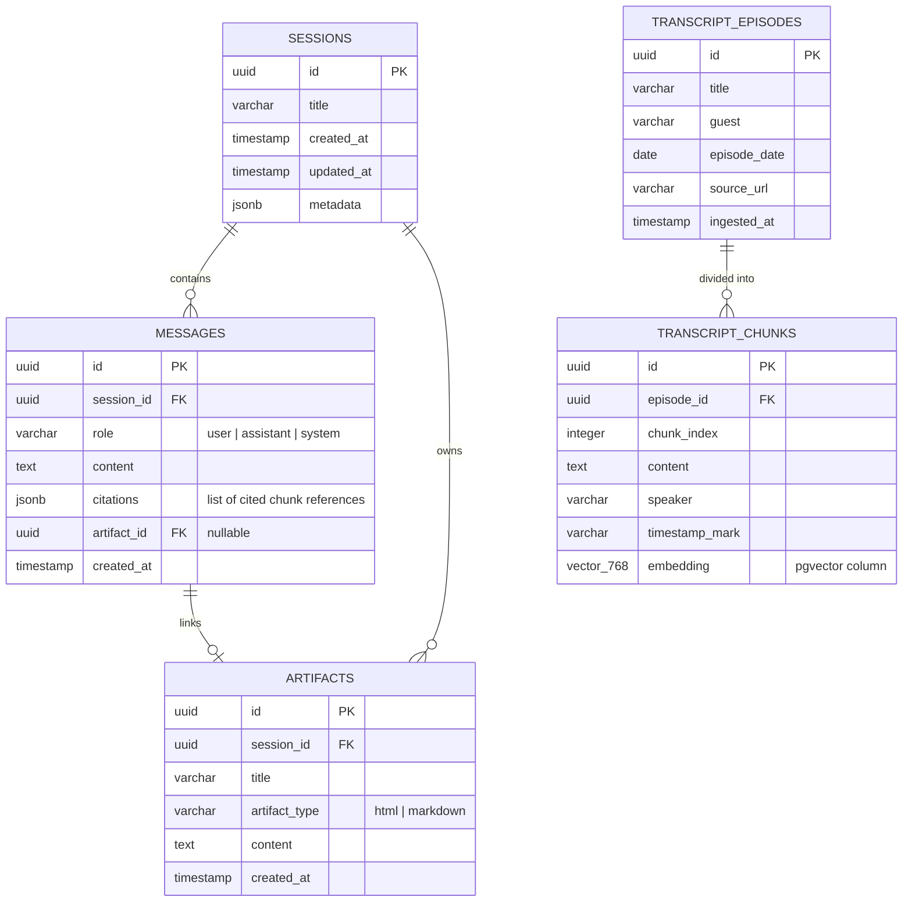

# System Architecture Specification: The Lenny Growth Assistant

- **Document Version:** 1.0.0
- **Status:** Approved / Phase 2 Baseline
- **Target Hardware:** MacBook Air (Dual-core Intel Core i5, 8 GB RAM)
- **Primary Stack:** FastAPI (Python 3.12+), React (TypeScript, Vite), PostgreSQL 16 (`pgvector`), Ollama (`llama3.2:3b`, `nomic-embed-text`)

---

## 1. High-Level System Architecture

The Lenny Growth Assistant is structured as a decoupled, local-first client-server application. All storage, vector similarity searches, and default LLM inferences occur strictly on the local machine.



---

## 2. Component Architecture

### 2.1 Frontend Client (React 18, TypeScript, Vite)
- **State Management:** Lightweight React state with custom hooks (`useChatSession`, `useSSEStream`, `useArtifactViewer`).
- **Network Layer:** Fetch API with `ReadableStream` parser for real-time Server-Sent Events (SSE).
- **Artifact Viewer Sandbox:** Isolated `<iframe>` utilizing `srcdoc` rendering, Content Security Policy, and strict sandbox constraints.
- **Styling:** CSS variables design system with Tailwind utility classes for high responsiveness and accessibility.

### 2.2 Backend Service (FastAPI, Python 3.12, Uvicorn)
- **Async Runtime:** Non-blocking I/O using Python `asyncio` for SSE streaming and database pooling.
- **Persistence Layer:** SQLAlchemy 2.0 (asyncpg) with declarative ORM and Pydantic v2 schemas.
- **Provider Manager:** Dynamic model resolver routing queries to `OllamaProvider` or `CloudProvider`.

### 2.3 Agent & Skill Router Architecture
Rather than adding proprietary, heavy cloud agent SDKs that do not support offline Ollama inference, the application utilizes a **Deterministic Tool & Skill Router**:



- **Skill Contracts:**
  - `rag_qa_skill`: Ingests top-K retrieved chunks (3-5), formats prompt with verbatim citations, and verifies grounding.
  - `ship30_essay_skill`: Targets ~1,250 words, enforces 5-part structure (Hook, 3 Progression Pillars, Actionable Takeaways, Citations), and automatically outputs a linked HTML artifact.
  - `artifact_generator_skill`: Generates standalone, valid HTML/CSS or Markdown documents.
  - `fallback_chat_skill`: Conversational responses when no retrieval is needed.

---

## 3. Knowledge Retrieval Pipeline (RAG)



### 3.1 Ingestion Specifications
- **Input Corpus:** Curated transcript JSON/Markdown files containing `title`, `guest`, `date`, `url`, and `content`.
- **Chunking Algorithm:** Semantic sliding window of 600 tokens with 100-token overlap, preserving speaker boundaries.
- **Embedding Dimensions:** 768 dimensions via `nomic-embed-text`.
- **Index Type:** `HNSW` (Hierarchical Navigable Small World) index with cosine distance (`vector_cosine_ops`) for sub-50ms retrieval latencies.

---

## 4. Database Schema & Entity Relationship Diagram (ERD)



---

## 5. REST & SSE API Contracts

### 5.1 Session Endpoints
- `GET /api/sessions`: Returns list of all persistent chat sessions.
  - Response: `[{"id": "uuid", "title": "string", "created_at": "iso8601", "updated_at": "iso8601", "message_count": 4}]`
- `POST /api/sessions`: Create a new session.
  - Request: `{"title": "Optional initial title"}`
  - Response: `{"id": "uuid", "title": "New Session", "created_at": "iso8601"}`
- `GET /api/sessions/{id}`: Get session details and full ordered message history.
- `DELETE /api/sessions/{id}`: Delete session and cascade delete messages and artifacts.
- `PATCH /api/sessions/{id}`: Rename session title.

### 5.2 Conversational Streaming Endpoint
- `POST /api/chat/stream`: Initiates Server-Sent Events (SSE) streaming response.
  - Request Body:
    ```json
    {
      "session_id": "c1f7a0b3-1e58-492d-a2f0-93cb1017c6e0",
      "prompt": "How did Superhuman measure product-market fit?",
      "provider_override": "local_ollama"
    }
    ```
  - Response: `Content-Type: text/event-stream`
    ```
    event: status
    data: {"stage": "retrieving", "message": "Searching podcast transcripts..."}

    event: citations
    data: [{"id": "chunk-1", "guest": "Rahul Vohra", "episode": "Superhuman PMF Engine", "timestamp": "18:45", "quote": "..."}]

    event: token
    data: {"token": "According"}

    event: token
    data: {"token": " to"}

    event: artifact
    data: {"id": "art-1", "title": "Superhuman PMF Engine", "type": "html"}

    event: done
    data: {"message_id": "uuid", "total_tokens": 420}
    ```

### 5.3 Artifact Endpoints
- `GET /api/artifacts/{id}`: Fetch raw artifact code, type, and title.
- `POST /api/artifacts`: Create or update an artifact manually.

### 5.4 System Health & Models
- `GET /api/health`: Health probe reporting database status, Ollama reachability, loaded model, and chunk count.
- `GET /api/models`: Lists available local and cloud models and active configuration.
- `POST /api/models/switch`: Updates runtime active model provider.

---

## 6. LLM Provider Abstraction & Fallback Architecture

```python
class LLMProvider(ABC):
    @abstractmethod
    async def generate_stream(
        self,
        messages: list[ChatMessage],
        temperature: float = 0.2
    ) -> AsyncGenerator[str, None]:
        pass

    @abstractmethod
    async def health_check(self) -> ProviderHealthStatus:
        pass
```

- **`OllamaProvider` (Primary Local):**
  - Connects to `http://localhost:11434/api/chat`.
  - Configured with `llama3.2:3b`.
  - Timeout: 60s per turn; auto-cancels on client disconnect.
- **`CloudProvider` (Replaceable Adapter):**
  - Adapts OpenAI (`gpt-4o-mini`) or Anthropic (`claude-3-5-sonnet`).
  - Reads `OPENAI_API_KEY` or `ANTHROPIC_API_KEY` from environment variables.
- **Fallback Policy:**
  - If Ollama is offline and Cloud keys are configured: user can toggle cloud with 1 click.
  - If Ollama is offline and Cloud keys are missing: returns structured 503 HTTP status with diagnostic instructions (`"Run 'ollama serve' in terminal"`). Never crash or hang indefinitely.

---

## 7. Artifact Sandboxing Architecture

Generated HTML/CSS poses a potential XSS and parent-frame compromise vulnerability. The assistant enforces a multi-tier containment boundary:

```
+-------------------------------------------------------------------------------+
| PARENT APPLICATION (http://localhost:5173)                                    |
| [Chat UI, PostgreSQL API Keys, Local Storage, Session State]                  |
|                                                                               |
|   +-----------------------------------------------------------------------+   |
|   | <iframe                                                               |   |
|   |    sandbox="allow-scripts"                                            |   |
|   |    csp="default-src 'none'; style-src 'unsafe-inline';                |   |
|   |         script-src 'unsafe-inline'; img-src data: https:;"            |   |
|   |    srcdoc="...sanitized HTML content..."                              |   |
|   | >                                                                     |   |
|   |                                                                       |   |
|   |   ISOLATED SANDBOX WORKSPACE:                                         |   |
|   |   - window.parent: BLOCKED (DOMException: Blocked a frame with origin) |   |
|   |   - document.cookie: NULL / INACCESSIBLE                             |   |
|   |   - localStorage: BLOCKED                                             |   |
|   |   - fetch / XMLHttpRequest: BLOCKED BY CSP                            |   |
|   |   - top-navigation: BLOCKED                                           |   |
|   +-----------------------------------------------------------------------+   |
+-------------------------------------------------------------------------------+
```

---

## 8. Logging, Observability & Health Probes

- **Logging Format:** Structured JSON logging via Python `structlog` containing:
  - `timestamp`: UTC ISO-8601
  - `request_id`: UUID4 correlation header
  - `event`: e.g. `retrieval_complete`, `stream_token_start`, `error`
  - `latency_ms`: Duration of vector search and time-to-first-token
  - `active_provider`: `ollama` or `cloud`
- **Health Check (`GET /api/health`):**
  - Validates PostgreSQL connection pool.
  - Validates `pgvector` extension and chunk count.
  - Pings `http://localhost:11434/api/tags` to verify Ollama status.

---

## 9. Hardware Feasibility Verification (MacBook Air Intel i5, 8 GB RAM)

| Resource | Available on Host | Allocated / Peak Demand | Safety Margin | Status |
|---|---|---|---|---|
| **RAM** | 8.0 GB Physical | 6.8 GB (macOS 3.0 GB + Ollama 2.2 GB + App 0.8 GB + Browser 0.8 GB) | ~1.2 GB Headroom | **FEASIBLE (No thrashing)** |
| **CPU** | 2 Physical Cores (Intel i5) | 1 Active LLM Stream (Sequential generation per session) | High utilization during generation (~70-80%), drops to 2% idle | **FEASIBLE** |
| **Disk Storage** | Host SSD | Models: 2.3 GB (`llama3.2:3b` + `nomic-embed`). PostgreSQL data: < 150 MB. | Minimal (< 3 GB total) | **FEASIBLE** |
| **Concurrency** | N/A | Strictly 1 LLM inference per worker; incoming prompts queued. | Prevents CPU starvation | **FEASIBLE** |

### Flagged Expensive / Unsupported Assumptions:
- **Flag 1 (Heavy PyTorch in Backend):** In-process PyTorch or SentenceTransformers libraries would consume an extra 1.5 GB RAM. *Decision: Offloaded completely to Ollama's `nomic-embed-text`.*
- **Flag 2 (Real-time Whisper Audio Transcription):** Transcribing audio on Intel i5 in real time is computationally prohibitive. *Decision: Transcripts are pre-ingested as text/JSON.*
- **Flag 3 (Multi-tenant Vector Partitioning):** Excessive vector indices would degrade cache hits. *Decision: Single indexed table in `pgvector`.*

---

## 10. Requirement Traceability Matrix

| Assignment Requirement | Architecture Component | Implementation File(s) | Verification / Test |
|---|---|---|---|
| **Persistent Sessions** | PostgreSQL DB + Session Router | `backend/app/db/`, `backend/app/routers/sessions.py` | `test_sessions_persistence.py` |
| **RAG Ingestion & Citations** | Chunking Engine + pgvector | `backend/app/rag/`, `backend/app/db/vector.py` | `test_retrieval_citations.py` |
| **Evidence Guardrails** | Cosine Distance Threshold Filter | `backend/app/rag/retriever.py` | `test_insufficient_evidence.py` |
| **Ship 30 for 30 Skill** | Specialized Skill Handler | `backend/app/agent/skills/ship30.py` | `test_ship30_essay_skill.py` |
| **Sandboxed Artifact Viewer** | Sandboxed Iframe Container | `frontend/src/components/ArtifactViewer.tsx` | Playwright sandbox security test |
| **Ollama Local LLM** | OllamaProvider Adapter | `backend/app/providers/ollama.py` | `test_ollama_provider.py` |
| **Replaceable Cloud Adapter**| CloudProvider Adapter | `backend/app/providers/cloud.py` | `test_cloud_provider.py` |
| **Graceful Failure Handling** | Global Error Handler & Probes | `backend/app/main.py`, `backend/app/routers/health.py` | `test_failure_modes.py` |
| **Docker Compose** | Multi-container Compose config | `docker-compose.yml`, `Dockerfile` | `docker compose up --build` verification |
